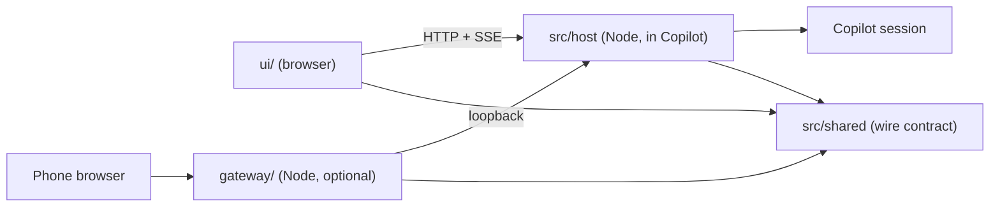

# Architecture

How Copilot Companion is organized, and the rules that keep it easy to change. Read this before you
move code or add a new area. [AGENTS.md](AGENTS.md) covers the day-to-day customization loop.

## The pieces

| Folder              | Runs in                | Owns                                                                 |
| ------------------- | ---------------------- | -------------------------------------------------------------------- |
| `src/extension.mts` | Copilot extension      | Entry: joins the session, wires the host together                    |
| `src/host/`         | Copilot extension      | Session bridge, prompts, controls and the loopback HTTP server       |
| `src/shared/`       | Anywhere               | The wire contract: types, limits, error codes and their validators   |
| `src/shared/node/`  | Node only              | Config, runtime state files and other code that needs `node:` APIs   |
| `ui/src/`           | Browser                | The canvas: layout, features, views and panels                       |
| `gateway/`          | Node, separate process | Phone access: provider discovery, proxy, push notifications          |
| `scripts/`          | Node, developer tools  | Install, phone setup, build sync and the `npx vp dev` preview mock   |
| `tests/`            | Node (Vitest)          | One folder per area: `host/`, `gateway/`, `ui/`, plus contract tests |
| `extension/`        | Copilot extension      | Generated, committed build output. Never edit it by hand             |

## Layering rules

Imports only point down this list. Lint enforces the arrows (see "Linting").

1. `src/shared/` (browser-safe) imports nothing from the repository except itself.
2. `src/shared/node/` may import `src/shared/`.
3. `src/host/` and `src/extension.mts` may import `src/shared/**`.
4. `gateway/` may import `src/shared/**`, never `src/host/`.
5. `ui/src/` imports shared code only through `ui/src/shared.ts`, and only browser-safe modules.
   It never imports `src/host/`, `src/shared/node/`, `gateway/` or `scripts/`.
6. `scripts/` may import anything it builds or runs. Nothing imports `scripts/` except
   `vite.config.ts` (the dev mock) and tests.

Why: the UI ships to a browser, the host ships inside `extension/`, and the gateway runs on its own.
Each must build without the others' runtime dependencies, and the contract is the only thing they
agree on.

## Shared code without a package manager

Shared code lives in plain source folders, not npm workspaces. Any package manager (npm, pnpm, Yarn,
Bun) works, and a fork needs no workspace setup. The rules above give the same separation a package
boundary would. If an area grows its own release cycle, promote its folder to a package then.

The installed extension must stay self-contained. Everything the host imports at runtime is compiled
from `src/` into `extension/`, so a link install of `extension/` alone works. Never import from
outside `src/` in host code.

## Modules

- **Small, deep modules.** A module hides real work behind a small interface: one factory, a few
  types. `createPromptService`, `createControlsService` and `createSessionBridge` are the model.
- **Split by responsibility, not by line count.** Split a file when it mixes jobs (parsing, state,
  I/O, transport). About 300 lines is a signal to look, not a rule. Do not split a file into
  forwarding-only wrappers.
- **Facades keep imports stable.** When a module becomes a folder, the old file re-exports the
  public names (`ui/src/api.ts`, `ui/src/markdown.ts`, `src/shared/contract.mts`). New code may import
  the facade; implementation files never import their own facade.
- **Feature folders in the UI.** `ui/src/features/<feature>/` holds a feature's components, hooks,
  pure logic and CSS module together. Shared shell parts stay in `ui/src/layout/`. Customizations
  stay in `ui/src/views/` and `ui/src/views/panels/`, listed in `ui/src/views/registry.ts`.
- **Erasable TypeScript only.** No enums, namespaces or parameter properties: Node runs the gateway
  and scripts by stripping types.

## Testable by design

- **Inject the edges.** Session RPC, clocks, transports and push senders are parameters with real
  defaults, so tests pass fakes (`tests/host/fixtures.ts`, `tests/gateway/fixtures.ts`).
- **Pure logic in plain functions.** Validation, parsing, formatting and decisions (for example the
  Escape-to-stop rule) are functions with no DOM or network, tested in Node.
- **Test through the interface.** Tests call the factory or the HTTP route, not internal helpers.
  Before you move code, add a characterization test that passes on the old code, then keep it green.
- **Tests mirror the source.** `tests/host/`, `tests/gateway/`, `tests/ui/` and `tests/*.test.ts`
  for the contract and cross-cutting checks.

## Safety invariants

These never change in a refactor:

- The provider and the gateway bind to `127.0.0.1` only.
- Every state-changing request passes the one security gate in `src/host/http/` (Host, Origin, CSRF,
  generation and session checks). Add new POST routes behind it, never beside it.
- Nothing answers a permission, question or plan without an explicit user action.
- The phone tunnel is owner-only.
- No secrets in `template.config.json`, the repository or `extension/`.

## Linting

`npx vp check` runs formatting, type checks and oxlint with the Vite+ recommended defaults. On top
of the defaults, `vite.config.ts` adds two architecture rules:

- `import/no-cycle` (type-only imports excepted) keeps the module graph acyclic.
- `no-restricted-imports` enforces the layering rules above. Tests are exempt.

It also adds `react/forbid-elements` for `ui/**/*.tsx`, which rejects raw controls and landmarks in
favor of native Mantine components (see "UI: native Mantine first" in AGENTS.md).

Keep the defaults; add a rule only when it guards a real boundary or a bug class this repository has
hit.

## Caching and performance

- **Static files** (`src/host/http/assets.mts`): hashed chunks are `public, max-age=31536000,
  immutable`; `index.html`, icons and the manifest are `no-cache` with an ETag (304 on a match).
  Text files over 1 KB go out brotli or gzip, compressed once per file version
  (`compression.mts`). API JSON is never compressed: `api/bootstrap` carries the CSRF token next to
  transcript text.
- **JSON reads** that are safe to reuse (`sendReadJson`): `private, no-cache` plus an ETag, and the
  page fetches with `cache: "no-cache"` so an unchanged answer is a 304. Bootstrap, writes and
  anything sensitive stay `no-store`.
- **Gateway** (`gateway/server/proxy.mts`): forwards `accept-encoding` and `if-none-match`, keeps the
  provider's caching headers for the page, assets and revalidating JSON reads, and answers repeat
  `api/skills` reads from a 15-second in-memory copy (`get-cache.mts`, per provider run).
- **Phone app shell** (`gateway/sw.js`): the worker precaches the page and the files it links;
  the page is network first, hashed chunks cache first, other static files stale while
  revalidate. API calls and the event stream are never cached; a gateway restart plus one reopen
  of the home-screen app picks up a new worker.
- **Transcript**: rows are virtualized above 80 entries, streamed text arrives as SSE `append`
  events and is applied once per animation frame, and a reconnect resumes from `Last-Event-ID`.

## Chat input and transcript

The composer uses native Mantine controls, a width-aware toolbar, attachments, a slash-skill
picker and browser speech recognition when supported. Keys: Enter sends, Ctrl/Cmd/Alt+Enter
queues, Shift+Enter adds a line, Alt+M cycles the session mode and Ctrl+Space (or the microphone)
starts and stops dictation; Escape also stops it. The page's own recognizer (`SpeechRecognition`)
does the listening: words not yet final show dimmed after the draft, final phrases join the draft
(a later phrase of one recording after a full stop), the recognizer restarts itself after a pause
and the microphone is released when the page hides. Dictation only fills the draft; it never sends
automatically. Recognition uses the browser's speech service and may require network access; where
the browser has none, the microphone is shown disabled. There are no host audio endpoints, API
keys or paid speech integrations, and the template must stay free of them.

`GET api/skills` reads the current session's bounded skill catalog. Skill expansion happens only
after an explicit send, through that session's command RPC. `GET api/context` reads measured
context usage; automatic compaction events are displayed, but the canvas cannot initiate compaction.
Queue editing (edit, move, remove, and Send now) uses `POST api/queue` behind the existing CSRF,
generation and session policy. Send now sends the item's text as a normal message, then removes it;
a repeated `requestId` replays the first outcome instead of sending again. Each queue item carries
`queuedAt` (the session's time, else when the host first saw it); the page shows "Queued 2m ago"
and highlights Send now after five minutes.
The phone gateway forwards `GET api/skills`, `GET api/context` and `POST api/queue` (pinned to the
live provider run like every other write), so the skill picker, context meter and queue editing
work on the phone too.

Activity summaries are bounded and redacted on the host. Reasoning remains expandable; tools
are shown for the running turn. Streaming SSE appends are batched in sequence per animation frame.
Long transcripts are virtualized; browser find only covers mounted rows above 80 rows.
Markdown uses `markdown-to-jsx` with raw HTML disabled, safe link validation and no remote images.
Fenced code is highlighted lazily with `highlight.js` and has a clipboard action.

Preview fixtures include a skill catalog, context usage, code fences and tool activity (`?state=busy`).

## Changing the structure

1. Add or update characterization tests for the area.
2. Move code behind the existing interface; keep a facade if others import it.
3. Run `npx vp check`, `npx vp test` and `npm run build`, and commit `extension/` with the source.
4. Update this file, `AGENTS.md` and the skills in `.github/skills/` when paths change.
