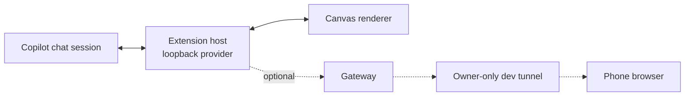

# Copilot Canvas

Your Copilot conversation in a calm, three-column window, on your computer and on your phone.
Answer Copilot's questions and approvals from anywhere, and shape the whole thing into your own just
by asking.

<br>

<p align="center">
  <a href="https://github.com/copilot/app/launch?open=ghapp%3A%2F%2Fsession%2Fnew%3Frepo%3Dms-jb%252Fcopilot-canvas%26mode%3Dinteractive%26prompt%3DSet%2520up%2520Copilot%2520Canvas%2520for%2520me%2520by%2520following%2520SETUP.md%2520in%2520this%2520repository."></a>
</p>

<p align="center">
  <b>One click. About five minutes. No coding.</b><br>
  <sub>Opens the GitHub Copilot app (or offers to install it first). Copilot does the setup and asks
  before anything important.</sub>
</p>

<br>

<table>
  <tr>
    <td width="72%"></td>
    <td width="28%"></td>
  </tr>
</table>

<details>
<summary>Dark theme</summary>


</details>

## What happens when you click Install

1. The GitHub Copilot app opens a new chat that is ready to set up the canvas. Confirm it.
2. Copilot asks you one question: go ahead, skip the phone, or pick another folder.
3. It makes your own copy of Copilot Canvas (a fork on your GitHub account, so your changes are
   yours; sharing them is up to you), installs it and opens it next to your chat.
4. For your phone, it shows a QR code. Scan it, sign in with the same account, and say hello. The
   canvas then walks you through adding it to your home screen like an app.
5. Then, in the same chat, it asks what you'd like to see and builds your first panels. You can
   follow along and approve each step from your phone.

The full playbook Copilot follows is in [SETUP.md](SETUP.md).

> [!NOTE]
> The one-click link needs the Copilot app signed in with a **github.com** account. Without one,
> paste this into any Copilot chat instead: _"Set up Copilot Canvas by following
> https://github.com/ms-jb/copilot-canvas/blob/main/SETUP.md"_.

## What you see

- **Your conversation** in the center, with timestamps, formatting and code.
- **What Copilot is doing** (thinking, responding, running a tool, waiting on you) above the box you
  type in.
- **Decisions** (permission requests, questions and plan approvals) answered right in the canvas, so
  you never have to switch windows.
- **Session settings** (mode, model, reasoning effort) as buttons by the box you type in.
- **Your own panels** on the right, starting with a few ideas you can tap.

## Make it yours

Ask Copilot in any chat, or tap one of the ideas in the canvas's empty right-hand side. Copilot
changes your copy of the canvas, rebuilds it, and asks you to tap **Reload extensions** (the
circular arrow at the top) to see it. Then ask for the next thing. Some ideas:

- _"Add a panel to my canvas that shows my open pull requests."_
- _"Add a Notes view to my canvas's sidebar where I can keep a scratchpad."_
- _"Rename my canvas assistant to Atlas and use a teal accent."_
- _"Add a checklist for today to my canvas that I can tick off."_

Copilot follows [AGENTS.md](AGENTS.md) when it works on your copy, so it edits the canvas itself
instead of opening something else.

## Open on phone

Setup does this for you. To start it again later (for example after a restart), run this in your copy:

```bash
npm run phone
```

It creates (once) a private dev tunnel that only you can sign in to, starts the gateway, and prints
the link and a QR code; the canvas's **Open on phone** button shows the same code. Keep it running,
and your computer awake, while you use your phone. On the phone, the canvas walks you through
adding it to your home screen so it opens like an app.

<details>
<summary>What it does, step by step</summary>

1. Signs in to dev tunnels (`devtunnel user login -d`) if needed.
2. Creates an owner-only tunnel once and remembers its id outside the repository. A tunnel that
   grants anyone else access is refused, never changed.
3. Adds port 47600 with `--origin-header unchanged`, so the gateway can check the phone's exact
   address.
4. Hosts the tunnel and starts the gateway with `GATEWAY_ALLOWED_ORIGIN` set to the tunnel's address.

</details>

## How it works



| Component       | Role                                                                   |
| --------------- | ---------------------------------------------------------------------- |
| Extension host  | Binds to the session, serves the canvas and its API on loopback only   |
| Canvas renderer | The React UI: conversation, composer, decisions, your views and panels |
| Gateway         | Optional; forwards only the canvas's own requests to a dev tunnel      |
| Dev preview     | A scripted stand-in for the host, used by `npx vp dev`                 |

## Safety

- **Nothing is approved automatically.** Every permission, answer and plan approval is an explicit
  tap.
- **Only the owner can answer:** loopback-only server, a random path, per-run CSRF and generation
  checks, and an owner-only tunnel for the phone.
- **One session per canvas.** A canvas reads and writes only the session that opened it.
- **No silent resends.** If a send cannot be confirmed, your draft is kept.
- **Safe rendering.** Messages render without raw HTML; only web and email links open.
- **Quiet gateway.** It never logs messages or tokens. Anyone who can reach your tunnel can act as
  you, so keep it owner-only.
- **Reloads are pinned too.** Reloading extensions from the phone goes through the same generation,
  CSRF and session checks as a message. The phone reconnects once the canvas is open again on your
  computer.

## Troubleshooting

| Symptom                           | Fix                                                                    |
| --------------------------------- | ---------------------------------------------------------------------- |
| Canvas missing                    | Ask Copilot to follow SETUP.md, or restart the Copilot app             |
| A change doesn't show             | Tap **Reload extensions** (circular arrow), then open the canvas again |
| Two canvases, or an old one       | Another copy is installed; ask Copilot to remove the extra one         |
| No **Open on phone** button       | Run `npm run phone` in your copy, then open the canvas again           |
| Phone says it is not connected    | Open the canvas from your chat, then refresh the phone                 |
| Phone link stopped working        | Your computer slept or `npm run phone` stopped; start it again         |
| A setting is missing from the bar | Your Copilot version does not offer it yet                             |

Still stuck? [Open an issue](https://github.com/ms-jb/copilot-canvas/issues/new/choose).

## Developing the template

[](https://github.com/ms-jb/copilot-canvas/actions/workflows/ci.yml)

For people working on the template itself; [AGENTS.md](AGENTS.md) covers customizing a copy. Requires
Node.js 22.18+ (24 recommended) and npm. Scripts and the gateway run as TypeScript through Node's type
stripping, so code must be erasable TypeScript (no enums or namespaces).

```bash
npx vp dev           # canvas with a built-in preview of the extension, no Copilot needed
npx vp check         # format, lint and type-check
npx vp test          # unit tests
npx vp build         # build the canvas into extension/
npm run install-ext  # build, then install this copy for your user
npm run phone        # owner-only dev tunnel plus gateway for the phone
```

Append a query to the `npx vp dev` page to preview other states:

| Query               | Shows                                     |
| ------------------- | ----------------------------------------- |
| (none)              | sample conversation and a scripted loop   |
| `?state=empty`      | a new session with no messages            |
| `?state=waiting`    | the session waiting on you                |
| `?state=busy`       | a reply mid-stream                        |
| `?state=nocontrols` | a Copilot version without native settings |

`DEV_PUBLIC_URL=https://...` changes the preview's Open on phone origin; `DEV_PUBLIC_URL=off` hides
it.

| Folder           | Contents                                                    |
| ---------------- | ----------------------------------------------------------- |
| `extension-src/` | extension host, compiled to `extension/`                    |
| `ui/`            | React + Mantine canvas; views and panels in `ui/src/views/` |
| `gateway/`       | optional phone gateway                                      |
| `scripts/`       | install, phone, sync and the development preview            |
| `extension/`     | generated, committed, installable output (do not hand-edit) |

- Settings live in `template.config.json`, which ships with the extension, so keep secrets out of
  it. `ASSISTANT_NAME`, `EXTENSION_NAME`, `CANVAS_ID` (keep it stable), `GATEWAY_PORT` and
  `GATEWAY_ALLOWED_ORIGIN` override it.
- `npm run install-ext [name] [--force] [--dir <extensions-root>]` replaces only an earlier install
  of this canvas (its own or a link install with the same canvas id) unless you pass `--force`, and
  records where it was installed from so the canvas's suggestions point Copilot at this copy.
- Rebuild and commit `extension/` after any change; link installs use it.

## Stack


## License

Released under the [MIT License](LICENSE).
