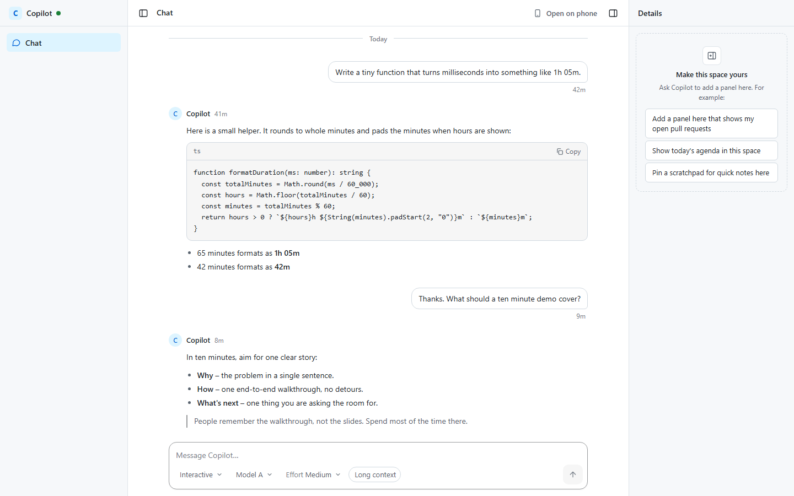
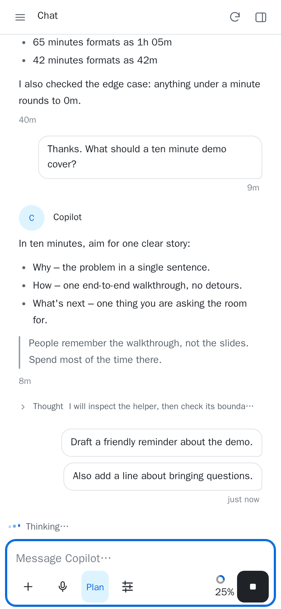
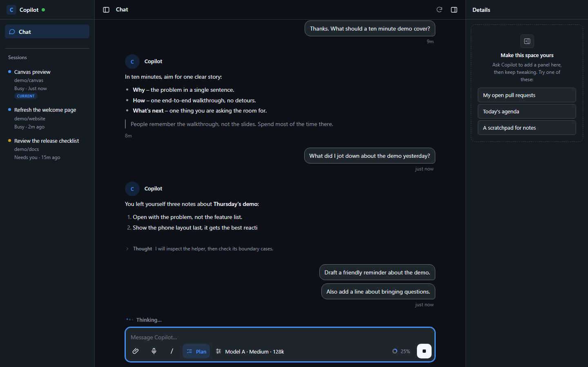
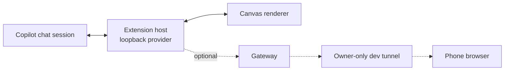

# Copilot Canvas

[](https://github.com/ms-jb/copilot-canvas/actions/workflows/ci.yml)

Your Copilot chat session in a calm, three-column canvas: your views on the left, the conversation
in the middle, your own panels on the right. Answer permission requests, questions and plan
approvals right in the canvas, even from your phone, and shape the whole thing just by asking
Copilot. It works with any Copilot chat session where the extension is loaded, with no extra setup.

[](#getting-started)
[](CONTRIBUTING.md)
[](https://github.com/ms-jb/copilot-canvas/issues/new/choose)
[](#make-it-yours)
[](https://github.com/ms-jb/copilot-canvas/tree/main/extension)

<table>
  <tr>
    <td width="72%"></td>
    <td width="28%"></td>
  </tr>
</table>

<details>
<summary>Dark theme</summary>



</details>

## Getting started

In the Copilot app, open the **Install canvas extension** dialog and paste:

```
https://github.com/ms-jb/copilot-canvas/tree/main/extension
```

Or install from a clone with `npm install` and `npm run install-ext`. Reload extensions, then open
the canvas from your chat session.

> [!TIP]
> The canvas binds to the session that opens it. Open it from each chat you want to follow; every
> canvas reads and writes only its own session.

**What you see**

- **Conversation** in the center, with Markdown, code blocks and timestamps.
- **Activity** (thinking, responding, running a tool, waiting on you) in the line above the
  composer.
- **Decisions** – permission requests, questions and plan approvals – answered right in the canvas,
  so you never have to switch to the app.
- **Connection health** as the dot next to the assistant's name; a banner appears only when
  something needs your action.
- **Session settings** (mode, model, reasoning effort, long context) as pills in the composer.
- **Your panels** on the right, starting with an invitation to ask Copilot to add one.

## Make it yours

Ask Copilot in chat. Describe what you want and it updates the canvas for you:

- _"Add a panel to the right side that shows my open pull requests."_
- _"Add a Notes view to the sidebar where I can keep a scratchpad."_
- _"Rename the assistant to Atlas and use a teal accent."_
- _"Open the Notes view first when the canvas starts."_
- _"Add a panel with a checklist for today that I can tick off."_

Reload the canvas when Copilot is done to see the change.

## Open on phone

An optional gateway makes the canvas reachable from your phone through an **owner-only** dev
tunnel. With several sessions open, it follows the session whose canvas was opened most recently.

1. Create and host an owner-only tunnel for port 47600 (never anonymous access):

   ```bash
   devtunnel user login
   devtunnel create
   devtunnel port create -p 47600
   devtunnel host
   ```

2. Start the gateway with the tunnel's exact origin:

   ```bash
   GATEWAY_ALLOWED_ORIGIN=https://<tunnel-id>-47600.<region>.devtunnels.ms npm run gateway
   ```

   PowerShell: `$env:GATEWAY_ALLOWED_ORIGIN="https://..."; npm run gateway`

3. Scan the QR code from the terminal or the canvas's **Open on phone** button and sign in as the
   tunnel owner.

## How it works



| Component       | Role                                                                   |
| --------------- | ---------------------------------------------------------------------- |
| Extension host  | Binds to the session, serves the canvas and its API on loopback only   |
| Canvas renderer | The React UI: conversation, composer, decisions, your views and panels |
| Gateway         | Optional; forwards only the canvas's own requests to a dev tunnel      |
| Dev preview     | A scripted stand-in for the host, used by `npx vp dev`                 |

## Safety

- **Nothing is approved automatically.** Every permission, answer and plan approval is an explicit
  tap.
- **Only the owner can answer:** loopback-only server, a random path, per-run CSRF and generation
  checks, and an owner-only tunnel for the phone.
- **One session per canvas.** A canvas reads and writes only the session that opened it.
- **No silent resends.** If a send cannot be confirmed, your draft is kept.
- **Safe rendering.** Messages render without raw HTML; only web and email links open.
- **Quiet gateway.** It never logs messages or tokens. Anyone who can reach your tunnel can act as
  you, so keep it owner-only.

## Troubleshooting

| Symptom                           | Fix                                                             |
| --------------------------------- | --------------------------------------------------------------- |
| Canvas missing                    | Reload extensions in the Copilot app or CLI                     |
| The canvas asks you to reload     | The extension restarted; reload the canvas                      |
| No **Open on phone** button       | Start the gateway, then reload the canvas                       |
| Phone says it is not connected    | Open the canvas from your chat session, then reload the page    |
| Blocked through the tunnel        | `GATEWAY_ALLOWED_ORIGIN` must match the phone's address exactly |
| A setting is missing from the bar | Your Copilot version does not offer it yet                      |

Still stuck? [Open an issue](https://github.com/ms-jb/copilot-canvas/issues/new/choose).

## Developing the template

For people working on the template itself. Requires Node.js 22.18+ (24 recommended) and npm.
Scripts and the gateway run as TypeScript through Node's type stripping, so code must be erasable
TypeScript (no enums or namespaces).

```bash
npx vp dev     # canvas with a built-in preview of the extension, no Copilot needed
npx vp check   # format, lint and type-check
npx vp test    # unit tests
npx vp build   # build the canvas into extension/
```

Append a query to the `npx vp dev` page to preview other states:

| Query               | Shows                                     |
| ------------------- | ----------------------------------------- |
| (none)              | sample conversation and a scripted loop   |
| `?state=empty`      | a new session with no messages            |
| `?state=waiting`    | the session waiting on you                |
| `?state=busy`       | a reply mid-stream                        |
| `?state=nocontrols` | a Copilot version without native settings |

`DEV_PUBLIC_URL=https://...` changes the preview's Open on phone origin; `DEV_PUBLIC_URL=off` hides
it.

| Folder           | Contents                                                    |
| ---------------- | ----------------------------------------------------------- |
| `extension-src/` | extension host, compiled to `extension/`                    |
| `ui/`            | React + Mantine canvas; views and panels in `ui/src/views/` |
| `gateway/`       | optional phone gateway                                      |
| `scripts/`       | install, sync and the development preview                   |
| `extension/`     | generated, committed, installable output (do not hand-edit) |

- Settings live in `template.config.json`, which ships with the extension, so keep secrets out of
  it. `ASSISTANT_NAME`, `EXTENSION_NAME`, `CANVAS_ID` (keep it stable), `GATEWAY_PORT` and
  `GATEWAY_ALLOWED_ORIGIN` override it.
- `npm run install-ext [name] [--force] [--dir <extensions-root>]` never replaces a folder it did
  not create unless you pass `--force`.
- Rebuild and commit `extension/` after any change.

## Stack


## Contributing

Bugs, ideas and questions go to [Issues](https://github.com/ms-jb/copilot-canvas/issues). See
[CONTRIBUTING.md](CONTRIBUTING.md) before opening a pull request.

## License

Released under the [MIT License](LICENSE).
